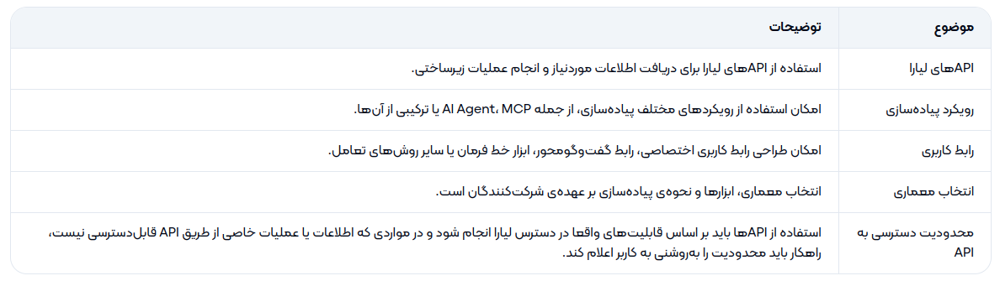
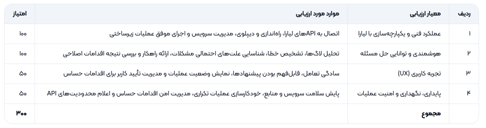

# Challenge Description

## قابلیت‌های مورد انتظار
## راه‌اندازی اولیه و اولین دیپلوی (Initial Setup & Deployment)

- راهنمایی کاربر برای انتخاب روش مناسب استقرار و راه‌اندازی اولیه‌ی وب‌سایت.
- بررسی نیازمندی‌های پروژه و پیشنهاد زیرساخت و پلن مناسب لیارا متناسب با نوع پروژه و منابع موردنیاز.
- کمک به انجام مراحل اولیه‌ی راه‌اندازی، پیکربندی و دیپلوی.
- راهنمایی برای تنظیم دامنه و انجام مراحل موردنیاز در پنل ثبت دامنه، مانند ایرنیک، در صورت نیاز.
- ساده‌سازی فرایند راه‌اندازی تا حدی که کاربر فقط مراحل ضروری و خارج از دسترس دستیار را انجام دهد.

## مدیریت دیپلوی و عملیات زیرساخت (Deployment & Operations)

- کمک به انتشار نسخه‌های جدید وب‌سایت.
- انجام یا راهنمایی فرایندهای پیکربندی و مدیریت سرویس از طریق APIهای لیارا.
- بررسی وضعیت سرویس و شناسایی خطاهای احتمالی در فرایند دیپلوی.
- خودکارسازی عملیات تکراری و کاهش نیاز به انجام دستی مراحل فنی.

## پایش و نگهداری (Monitoring & Maintenance)

- بررسی وضعیت سلامت سرویس و منابع مصرفی، از جمله CPU و RAM، در صورت دسترسی به داده‌های مربوطه.
- دریافت و تحلیل لاگ‌های مرتبط با سرویس.
- کمک به بررسی مشکلاتی مانند کندشدن وب‌سایت، اختلال در عملکرد یا افزایش مصرف منابع.
- ارائه‌ی پیشنهاد برای بهبود عملکرد و پایداری سرویس.
- امکان انجام اقدامات اصلاحی یا راهنمایی کاربر برای رفع مشکل.

## عیب‌یابی هوشمند (Intelligent Troubleshooting)

**در صورت بروز خطا، برای مثال خطای HTTP 500، دستیار باید بتواند:**

- اطلاعات مرتبط با خطا را از منابع در دسترس جمع‌آوری کند.
- لاگ‌ها، وضعیت سرویس و داده‌های منابع مصرفی را بررسی کند.
- علت‌های احتمالی مشکل را شناسایی و اولویت‌بندی کند.
- راهکار مناسب برای رفع مشکل ارائه دهد.
- در صورت داشتن مجوز، اقدام اصلاحی انجام دهد و نتیجه را بررسی کند.

مثال:

اگر وب‌سایت کند شده باشد، دستیار می‌تواند با بررسی شواهد موجود مشخص کند که آیا افزایش مصرف RAM، محدودیت CPU، خطاهای برنامه یا عامل دیگری محتمل است؛ سپس راهکار مناسب را پیشنهاد دهد.

## تعامل امن با کاربر (Human-in-the-Loop)

در عملیات حساس یا دارای پیامدهای مهم، دستیار باید پیش از اجرا از کاربر تأیید بگیرد. این عملیات می‌تواند شامل تغییرات پرریسک در تنظیمات، ری‌استارت سرویس یا تغییر پلن و منابع باشد.

راهکار باید بین عملیات کم‌ریسک قابل‌اجرا به‌صورت خودکار و عملیات حساس نیازمند تأیید کاربر تمایز قائل شود.

همچنین، نتیجه‌ی عملیات و خطاهای احتمالی باید برای کاربر قابل‌مشاهده باشد.

## محدودیت‌های فنی و ابزارهای در دسترس

## نکات و الزامات طراحی محصول

## تجربه‌ی کاربری (UX)

یکی از مهم‌ترین معیارهای این چالش، سادگی و سهولت استفاده برای کاربر نهایی است.

صرفا پیاده‌سازی قابلیت‌های فنی کافی نیست؛ راهکار باید بتواند عملیات پیچیده‌ی زیرساختی را به تجربه‌ای ساده، قابل‌فهم و قابل‌اعتماد تبدیل کند.

انتظار می‌رود کاربر بتواند:

- درخواست خود را با حداقل دانش فنی مطرح کند.
- وضعیت عملیات را بفهمد.
- پیشنهادهای دستیار را ارزیابی کند.
- در صورت نیاز، با تأیید خود اجازه‌ی اجرای عملیات را بدهد.

## خروجی مورد انتظار

به انتخاب شرکت کننده بستگی دارد: agent یا mcp یا ...

## چشم‌انداز نهایی

چشم‌انداز این چالش، ساخت دستیار هوشمندی است که بتواند نقش یک همکار فنی برای صاحبان وب‌سایت را ایفا کند؛ از اولین دیپلوی و انتخاب منابع مناسب تا پایش مستمر، تشخیص مشکلات و کمک به حفظ پایداری سرویس.

هدف نهایی این است که کاربر به‌جای درگیرشدن با پیچیدگی‌های زیرساخت، بر توسعه و بهبود محصول خود تمرکز کند.

## موارد تحویلی

## خروجی و مستندات موردنیاز

شرکت‌کنندگان باید یک نمونه‌ی اولیه‌ی قابل‌اجرا (MVP) ارائه دهند که بخش مشخصی از چرخه‌ی راه‌اندازی، دیپلوی یا نگهداری وب‌سایت را پوشش دهد.

نمونه‌ی اولیه باید علاوه بر نمایش قابلیت‌های فنی، یک سناریوی واقعی را از درخواست کاربر تا انجام عملیات یا تشخیص مشکل به نمایش بگذارد.

علاوه بر آن، یک داکیومنت md تهیه کنید و آن را در گیت‌هاب ذخیره کنید. این داکیومنت باید شامل موارد زیر باشد:

- مستندات کوتاه معماری.
- نحوه‌ی اتصال به APIهای لیارا.
- محدودیت‌های راهکار.
- نحوه‌ی تعامل کاربر با سیستم.

## ویدئوی دمو (الزامی)

- ارسال ویدئوی دمو از پروژه الزامی است.
- ویدئو باید حدود ۵ دقیقه باشد و در آن عملکرد پروژه نمایش داده شده و توضیح داده شود.
- در صورت عدم ارسال ویدئوی دمو، اثر از داوری حذف می‌شود.
- کیفیت ویدئو نیز در امتیاز کلی اثر تأثیرگذار است.
- در ویدئو خروجی کار را نشان دهید و نیازی به نمایش سورس کد نیست. عملکرد، تأثیر، خروجی و موارد قابل نمایش مهم است.
- کار خود را کامل پرزنت کنید. این موضوع خیلی مهم است.
- اگر امکان صحبت کردن ندارید، می‌توانید فقط از خروجی کار ویدئوی بی‌صدا بگیرید، اما امتیاز کمتری می‌گیرید. این حالت بهتر از آن است که اصلا امتیازی نگیرید.
- نیاز به ادیت خاصی نیست.

## معیارهای داوری

پروژه‌ها بر اساس معیارهای زیر ارزیابی خواهند شد:

## عملکرد فنی و یکپارچه‌سازی با لیارا: ۱۰۰ امتیاز

- اتصال به APIهای لیارا
- راه‌اندازی و دیپلوی
- مدیریت سرویس
- اجرای موفق عملیات زیرساختی

## هوشمندی و توانایی حل مسئله: ۱۰۰ امتیاز

- تحلیل لاگ‌ها
- تشخیص خطا
- شناسایی علت‌های احتمالی مشکلات
- ارائه راهکار
- بررسی نتیجه اقدامات اصلاحی

## تجربه کاربری: ۵۰ امتیاز

- سادگی تعامل
- قابل‌فهم بودن پیشنهادها
- نمایش وضعیت عملیات
- مدیریت تأیید کاربر برای اقدامات حساس

## پایداری، نگهداری و امنیت عملیات: ۵۰ امتیاز

- پایش سلامت سرویس و منابع
- خودکارسازی عملیات تکراری
- مدیریت امن اقدامات حساس
- اعلام محدودیت‌های API

## جدول بارم‌بندی

